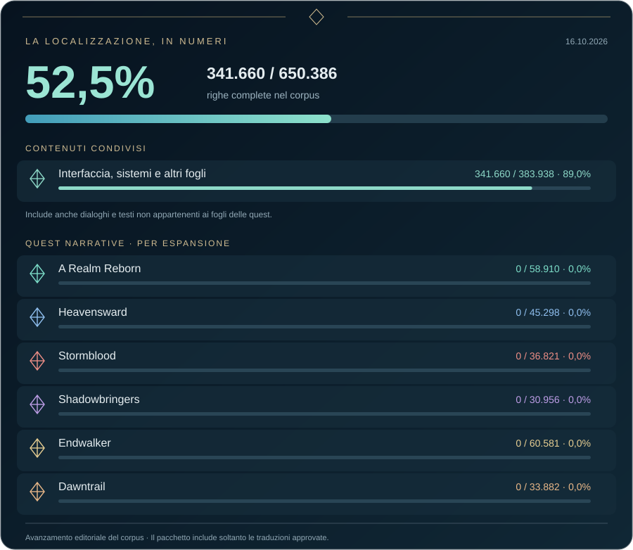

  

  <strong>La localizzazione italiana di Final Fantasy XIV.</strong> 
  Interfaccia, oggetti, azioni e testi di sistema nella tua lingua. 
  Le missioni e le cutscene sono il prossimo capitolo.

  

  <a href="https://github.com/IsamuBarbieri/FFXIV_Italian/releases">Versioni e note di rilascio</a> ·
  <a href="#installazione">Installazione</a> ·
  <a href="#avanzamento">Avanzamento</a> ·
  <a href="https://github.com/IsamuBarbieri/FFXIV_Italian/issues">Segnala un problema</a>

## Eorzea, in italiano

**FFXIV Italiano** è una localizzazione fan-made dei testi del gioco, distribuita come mod per Penumbra. Scarica il pacchetto, importalo e scegli quali parti della traduzione attivare. Penumbra applica le modifiche al client senza alterare gli archivi originali dell'installazione.

L'interfaccia è tradotta. Il lavoro prosegue sui testi narrativi: missioni, dialoghi e cutscene possono ancora apparire in inglese. La patch riguarda i testi; puoi mantenere il doppiaggio che preferisci.

| Contenuto | Cosa trovi in italiano |
| --- | --- |
| **Interfaccia e sistemi** | Menu, finestre, guide, tooltip e messaggi di gioco. |
| **Mondo e personaggi** | Luoghi, PNG, nemici, classi e mestieri. |
| **Oggetti e combattimento** | Nomi e descrizioni di oggetti, azioni, abilità, tratti e stati. |
| **Attività e collezioni** | Obiettivi, registri e contenuti delle attività. |
| **Missioni e cutscene** | Localizzazione narrativa in lavorazione, aggiunta nelle successive versioni. |

Le opzioni del mod permettono di attivare separatamente dieci blocchi: **Missioni**, **Nomi di PNG, nemici, luoghi e termini del mondo di gioco**, **Classi e mestieri**, **Oggetti**, **Oggetti legati a eventi**, **Oggetti collezionabili**, **Azioni, abilità, tratti e stati**, **Obiettivi**, **Registro di combattimento e messaggi di sistema**, **Interfaccia**. I blocchi presenti nel pacchetto sono attivi per impostazione predefinita.

## Installazione

### 1. Prepara gli strumenti

Servono Final Fantasy XIV installato su PC, XIVLauncher con Dalamud attivo e Penumbra funzionante. Per installare e configurare gli strumenti segui le guide dei rispettivi progetti:

| Strumento | Download e istruzioni |
| --- | --- |
| **XIVLauncher / Dalamud** | [Sito ufficiale](https://goatcorp.github.io/) · [Guida in italiano](https://github.com/goatcorp/FFXIVQuickLauncher/wiki/Info-%28Italian%29) |
| **Penumbra** | [Installazione ufficiale](https://github.com/xivdev/Penumbra#installing) |

### 2. Scarica la patch

Apri [l'ultima release](https://github.com/IsamuBarbieri/FFXIV_Italian/releases/latest) e scarica **`FFXIV_Italian.pmp`** dalla sezione **Assets**. Controlla nelle note la versione del client compatibile.

### 3. Importa e attiva

1. Imposta **inglese** come lingua dei testi del client: la patch localizza i dati della versione inglese.
2. Avvia il gioco con XIVLauncher e apri Penumbra con **`/penumbra`**.
3. Usa **Import** per importare `FFXIV_Italian.pmp`.
4. Seleziona **FFXIV Italiano**, attivalo nella collezione **Base / Default** e scegli i blocchi di traduzione desiderati.
5. Nelle impostazioni di Dalamud (**`/xlsettings`**), abilita **“Wait for plugins before game loads”**.
6. **Chiudi e riavvia completamente il gioco.**

L'attesa del caricamento dei plugin consente a Penumbra di applicare la localizzazione anche ai testi letti all'avvio, prima di entrare con il personaggio.

## Avanzamento

  

Il grafico mostra le **righe complete rispetto al corpus estratto**: una riga è completa quando tutti i suoi campi testuali previsti hanno una traduzione. I conteggi fotografano il lavoro editoriale e possono includere bozze; il pacchetto distribuisce soltanto le traduzioni approvate.

Le quest narrative sono raggruppate per espansione. L'interfaccia, i sistemi e gli altri fogli, compresi i dialoghi esterni a queste quest, compaiono nei **contenuti condivisi** e sono contati una sola volta. La percentuale complessiva comprende anche tutta la narrazione ancora da tradurre.

## Aggiornare o rimuovere la patch

Quando esce una nuova versione, scarica il nuovo `FFXIV_Italian.pmp`, rimuovi o disattiva il pacchetto precedente in Penumbra, importa quello aggiornato e riavvia il gioco. Mantieni attiva una sola versione della localizzazione.

Dopo una patch ufficiale di FFXIV, verifica la compatibilità nelle [note di rilascio](https://github.com/IsamuBarbieri/FFXIV_Italian/releases). Se la versione del client non è ancora supportata, disattiva temporaneamente la localizzazione.

Per tornare ai testi originali basta disattivare **FFXIV Italiano** in Penumbra e riavviare il gioco. Puoi anche rimuovere il mod dal plugin.

## Domande frequenti

<strong>Ho attivato la patch, ma vedo ancora tutto in inglese.</strong>

Controlla la lingua dei testi del client, la collezione Base / Default e l'attivazione del mod e dei suoi blocchi. Abilita l'attesa dei plugin in Dalamud e riavvia completamente il gioco: rientrare con il personaggio può non bastare per i testi già caricati.

Se alcuni menu sono italiani ma una missione o una cutscene è inglese, quel testo può essere ancora in lavorazione.

<strong>Il gioco è stato aggiornato e Dalamud o Penumbra non sono disponibili.</strong>

Attendi l'aggiornamento degli strumenti e controlla che la release della localizzazione supporti il nuovo client. Per problemi del launcher o del plugin consulta la [FAQ di XIVLauncher](https://goatcorp.github.io/faq/) e il [progetto Penumbra](https://github.com/xivdev/Penumbra).

<strong>Una macro che richiama azioni per nome non funziona più.</strong>

Controlla che il nome dell'azione nella macro coincida con quello visualizzato dopo la localizzazione. Puoi anche disattivare il blocco **Azioni, abilità, tratti e stati** nelle opzioni della patch.

<strong>Vedo un testo tagliato, una traduzione errata o un problema durante il gioco.</strong>

Apri una [segnalazione](https://github.com/IsamuBarbieri/FFXIV_Italian/issues/new) indicando versione del client e della patch, schermata o passaggi per riprodurre il problema e il luogo preciso: menu, oggetto, PNG o missione. Per problemi di funzionamento indica anche se persistono dopo aver disattivato la localizzazione.

## Dietro la localizzazione

Per chi mantiene il progetto, i riferimenti operativi sono:

- [Traduzione da zero](docs/TRANSLATION.md) — contesto, corpus, registri e SeString.
- [Revisione](docs/REVISION.md) — controlli, feedback e riconciliazione delle discrepanze.
- [Aggiornamento del client](docs/CLIENT_UPDATE.md) — confronto e integrazione dopo le patch del gioco.
- [Architettura e manutenzione](docs/ARCHITECTURE.md) — build, strumenti e asset.

---

  <strong>Una localizzazione della community, per la community italiana.</strong> 
  Progetto fan-made, non ufficiale e non affiliato a Square Enix. 
  Final Fantasy XIV, i suoi testi, personaggi e marchi appartengono a Square Enix.

